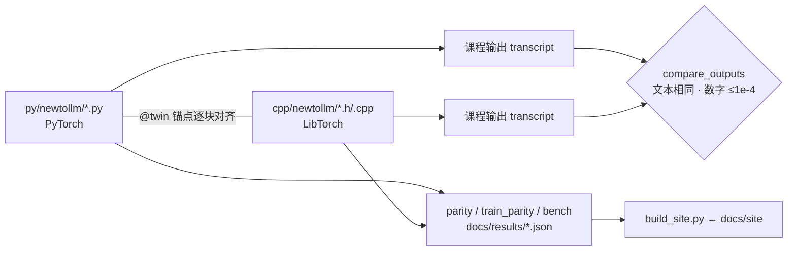

# NewToLLM：一个 GPT，写两遍（PyTorch ⇄ LibTorch）

同一个 GPT-2 小模型，左边 **PyTorch**，右边 **LibTorch (C++)**。文件名、类名、函数名、打印格式一一对应；
同一个随机种子在两边抽出逐位相同的权重，训练出几乎重合的 loss 曲线。

**对照站点**：`docs/site/index.html`（由 `tools/build_site.py` 从源码和实测 JSON 生成，可通过 GitHub Pages 发布）。
站点里有逐块对齐的双胞胎代码、黄色高亮的 API 差异（悬停看解释）、mermaid 结构图、parity 误差表、训练曲线和 benchmark 图。



## 快速开始

```bash
# Python
pip install torch --index-url https://download.pytorch.org/whl/cpu
pip install -e ".[dev]"
PYTHONPATH=py python -m newtollm list
PYTHONPATH=py python -m newtollm attention

# C++（LibTorch ≥ 2.10，CMake ≥ 3.24，C++20）
# 把 LibTorch 解压到 vendor/libtorch，或用 -DLIBTORCH_VENDOR_PATH=... 指定
cmake -S . -B build -DCMAKE_BUILD_TYPE=Release -DCMAKE_EXPORT_COMPILE_COMMANDS=ON
cmake --build build -j
./build/bin/newtollm attention

# 对照与门禁
python tools/parity.py            # 同种子初始化 + 前向 logits
python tools/train_parity.py      # 逐步训练 loss
python tools/bench.py             # 前向 / 训练步耗时
python tools/build_site.py        # 重新生成 docs/site（--check 检查是否过期）
tools/lint.sh build               # ruff, mypy --strict, twins, clang-format, clang-tidy
ctest --test-dir build && python -m pytest tests
```

## 课程

| # | 双胞胎文件 | 内容 |
|---|---|---|
| 00 | `report` `config` `tokenizer` | 统一打印格式、共享 `configs/presets.json`、离线 GPT-2 BPE（`assets/gpt2.tiktoken`） |
| 01 | `tensors` | 创建、形状、索引、广播（`x[:, 1:]` ⇄ `x.index({Slice(), Slice(1, None)})`） |
| 02 | `autograd` | `requires_grad`、`backward`、手写 SGD、`no_grad` ⇄ `NoGradGuard` |
| 03 | `modules` | GELU / LayerNorm / FeedForward，`nn.Module` ⇄ `Module + TORCH_MODULE` |
| 04 | `attention` | 因果多头注意力，`register_buffer`、`masked_fill` |
| 05 | `gpt` | TransformerBlock、GPTModel、贪心生成 |
| 06 | `data` `train` | 确定性数据管线（两边 batch 完全相同）、AdamW 预训练 |
| 07 | `finetune` | 垃圾短信分类：换分类头、冻结参数、准确率 |

## 门禁（CI 全部执行）

- **twins**：两边 `@twin` 锚点集合与顺序必须一致（`tools/check_twins.py`）。
- **transcript**：每课两边输出逐行比较（`tools/compare_outputs.py`）。
- **parity**：同种子初始化逐位相同，前向 logits 误差 ≤ 1e-4；训练 parity 要求步数相同、逐步 loss 误差 ≤ 1e-4。
- **lint**：ruff、mypy --strict、clang-format、clang-tidy。
- **site**：`build_site.py --check` 保证页面与源码、实测结果同步。

实测数字见站点的“实测结果”页（数据来自 `docs/results/*.json`，不手写）。benchmark 是在共享 CPU 机器上测的，只说明量级，不说明谁绝对更快。

## 已知差距

- 只在 Linux CPU 上验证；macOS、CUDA 未测。
- 没有加载 OpenAI GPT-2 预训练权重，也没有指令微调；`gpt2` 档位只做初始化/前向 parity。
- Python 用的 PyTorch 与 C++ 用的 LibTorch 版本可能不同，benchmark 会在结果里记录两边版本。

## 历史

v1（`python_impl/`、`cpp_impl/`）已在第 7 步删除，可在 git 历史和 `New-archieve` 分支中查看。设计见 `docs/REDESIGN_PLAN.md`。
